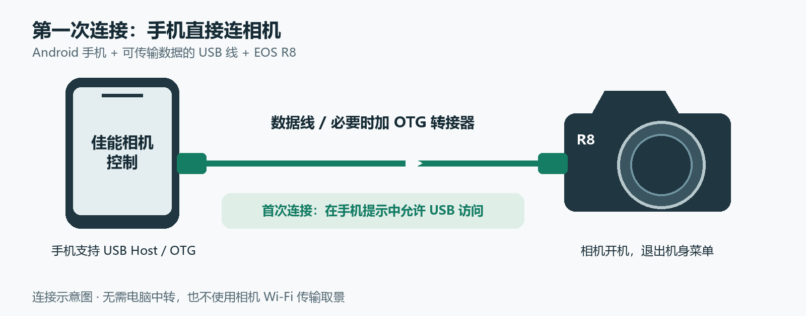
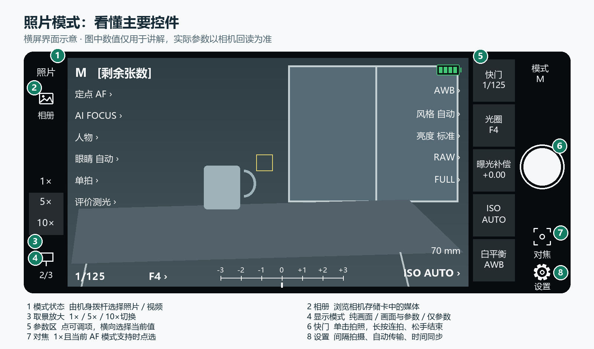

# 佳能相机控制

**用 Android 手机，通过 USB 直接遥控佳能相机。** 查看实时画面、拍照 / 录像、调整机身开放的参数，并浏览和传输存储卡里的媒体。主要开发与实测机型为 **EOS R8**。

**[下载 0.5.82 APK](https://github.com/topsai/CanonCamera-R8-Releases/releases/download/android-v0.5.82/CanonCamera-Android-0.5.82.apk)** · [图文使用手册](docs/user-guide.md) · [更新日志](CHANGELOG.md) · [反馈问题](https://github.com/topsai/CanonCamera-R8-Releases/issues)

> 当前为开发预发布版。支持 Android 8.0 及以上，手机须支持 USB Host / OTG；其他机型与固件的完整兼容性尚未确认。本项目不是佳能官方应用。

## 快速开始

1. **安装**：下载上方 APK，按 Android 系统提示安装。
2. **连接**：相机开机并退出菜单，用可传输数据的 USB 线连接手机；必要时使用 OTG 转接器。
3. **授权并使用**：打开 App，允许系统 USB 访问，等待出现相机型号和实时画面。

不需要电脑中转、相机 Wi-Fi、开发者模式或无线调试。[遇到连接问题？](docs/user-guide.md#faq)

## 看懂拍摄页面

图中是**界面示意**，数值与场景仅用于讲解。完整手册还提供[视频页面](docs/user-guide.md#video)和[两种模式的设置图解](docs/user-guide.md#settings)，图片可点开查看大图。

| 想做什么 | 从哪里进入 |
| --- | --- |
| 拍一张 / 长按连拍 | [照片模式的白色快门按钮](docs/user-guide.md#photo) |
| 设置 App 计时的间隔拍摄 | [设置 → 间隔拍摄](docs/user-guide.md#photo) |
| 录制视频、修改规格和高帧率 | [机身切视频，再使用 REC 和可编辑参数](docs/user-guide.md#video) |
| 检查取景细节 | [1× / 5× / 10×；点击选焦请先回 1×](docs/user-guide.md#screen) |
| 导入 / 管理 LUT、开启斑马线 | [视频模式 → 设置](docs/user-guide.md#monitor) |
| 查看、下载相机媒体 | [相册与传输](docs/user-guide.md#album) |
| 同步时间或检查更新 | [设置](docs/user-guide.md#settings) |

**照片 / 视频状态由机身拨杆选择，App 中只做显示。** 参数能否修改由机身当前模式和开放的选项决定；没有有效数据时不显示虚构读数。

## 设置与使用提醒

- 照片设置包含间隔拍摄、点击后自动对焦、自动传输；视频设置包含 LUT 导入 / 管理和斑马线。绿色开关为开启，灰色为关闭。
- 同步相机时间是一次性按钮，不会自动校时。App 会后台检查新版，安装仍需系统确认。
- LUT 和斑马线只影响手机监看，不写入相机录像文件。RAW 预览使用内嵌 JPEG，不是 RAW 显影。
- 间隔拍摄由 App 计时，需要前台和 USB 连接。拍摄时请保持前台；机身能力、镜头与忙碌状态会影响可用操作。

[阅读完整使用手册](docs/user-guide.md) · [查看常见问题](docs/user-guide.md#faq)

## 更新日志

**0.5.82 · 2026-11-12**。相册日期分组和预览工具栏更紧凑统一；CR3 优先读取内嵌高清预览，视频加入缓冲和预读。高码率视频可能需要先等待缓存，以减少播放卡顿。

**0.5.67 已撤回公开下载**，请使用 0.5.82。历史说明保留在[完整更新日志](CHANGELOG.md)和[各版本 Release](https://github.com/topsai/CanonCamera-R8-Releases/releases)。

## 下载与项目范围

- [当前版本说明与 APK](https://github.com/topsai/CanonCamera-R8-Releases/releases/tag/android-v0.5.82)
- [全部公开版本](https://github.com/topsai/CanonCamera-R8-Releases/releases)
- [问题反馈](https://github.com/topsai/CanonCamera-R8-Releases/issues)：请附 App 版本、手机 / Android 版本、相机 / 固件及复现步骤，分享截图前遮去私人内容。

本仓库用于 Android APK、使用说明和示意图，App 源码保存在私有仓库。GitHub 自动生成的 Source code 压缩包只含本仓库的文档和说明用图片，**不含 App 源码**。Windows 是独立开发的程序，这个 APK 不能用于 Windows 或 iPhone。
