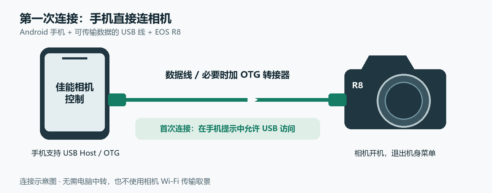
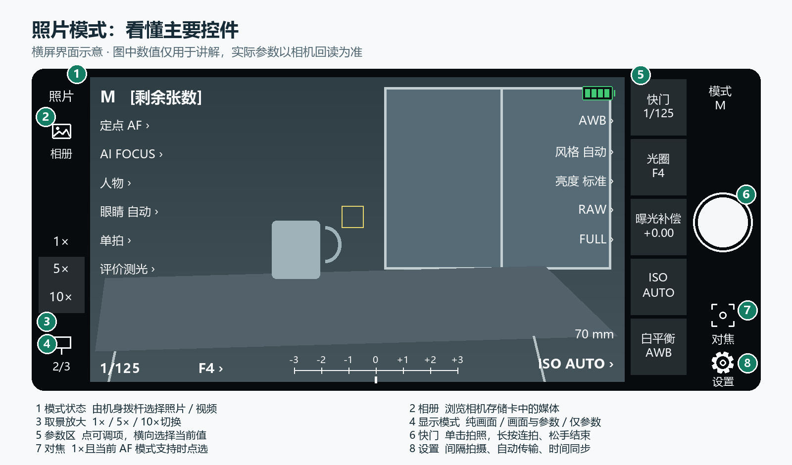
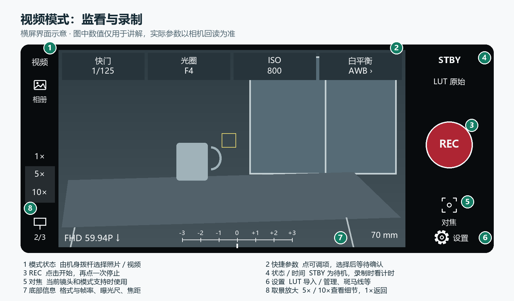
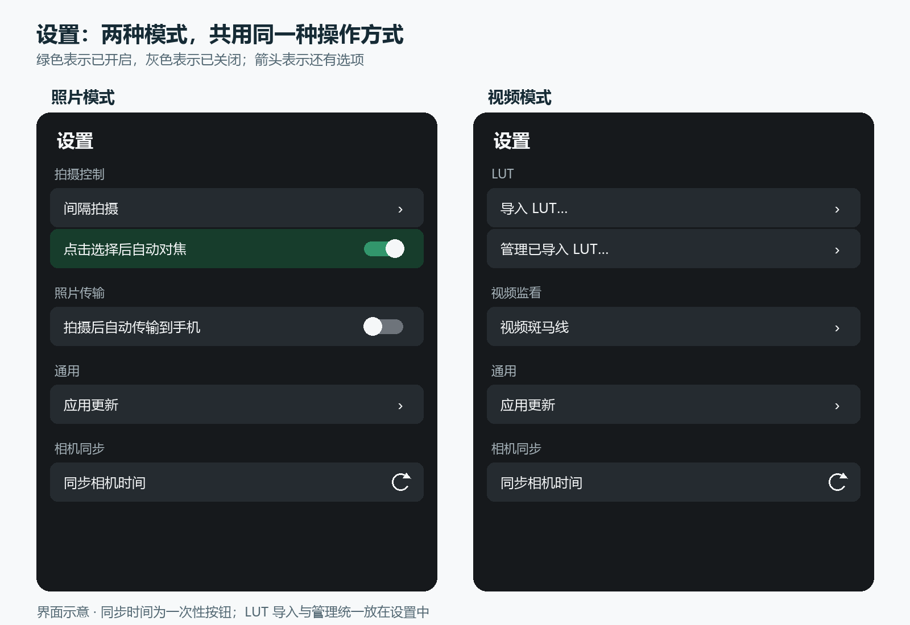

# 佳能相机控制使用手册

适用于 **Android 0.5.71**。使用手机通过 USB 连接相机，进行实时取景、遥控拍摄、视频监看和存储卡媒体管理。主要开发与实测机型为 **Canon EOS R8**；其他机型的可用参数以实际连接结果为准。

[返回主页](../README.md) · [下载 APK](https://github.com/topsai/CanonCamera-R8-Releases/releases/tag/android-v0.5.71) · [版本记录](https://github.com/topsai/CanonCamera-R8-Releases#更新日志)

> 本手册插图为界面示意，图中场景、数值和开关状态用于讲解，不是真实拍摄素材或默认配置。

## 目录

1. [安装与连接](#connect)
2. [认识拍摄页面](#screen)
3. [拍照、连拍与间隔拍摄](#photo)
4. [视频录制与规格选择](#video)
5. [LUT 与斑马线](#monitor)
6. [相册、预览与传输](#album)
7. [设置与时间同步](#settings)
8. [更新 App](#update)
9. [常见问题](#faq)

## 1. 安装与连接

### 准备什么

| 项目 | 要求 |
| --- | --- |
| 手机 | Android 8.0 或以上，支持 USB Host / OTG |
| 相机 | 当前主要验证 EOS R8，电量充足 |
| 数据线 | 能传输数据的 USB 线；手机接口需要时使用 OTG 转接器 |
| 安装包 | 从本项目 GitHub Release 下载的 `.apk` |

### 第一次使用

1. [下载 APK](https://github.com/topsai/CanonCamera-R8-Releases/releases/tag/android-v0.5.71)，按手机系统提示安装。系统如询问安装来源，确认你打开的是本项目的 APK。
2. 相机开机并回到正常取景，接好手机与相机之间的数据线。手机若有 OTG 开关，先开启。
3. 打开 App，在 Android 弹出的 USB 访问提示中选择允许。日常使用不需要开发者模式或无线调试。
4. 等待 App 识别相机。出现相机型号、实时画面及“断开”按钮，表示已经连接。

App 会自动发现和连接相机。主动点击“断开”会交还控制；要再次连接，点击“连接”。同一台相机应由一个遥控应用使用，先退出其他正在访问相机的应用。

**照片 / 视频状态由机身拨杆选择，App 中的状态名称只显示，不能点击切换。** 曝光档位 M、Av 等与照片 / 视频状态是两回事，以机身和当前可读参数为准。

## 2. 认识拍摄页面

手机横竖屏会自动调整布局，主要操作相同。点击“显示”循环切换，长按可直接选择；照片和视频分别记忆自己的显示模式。

| 显示 | 内容 | 适合什么时候用 |
| --- | --- | --- |
| 1/3 · 纯画面 | 尽量保留画面，减少参数遮挡 | 构图、观看画面 |
| 2/3 · 画面与参数 | 画面、常用参数、曝光尺等 | 拍摄时检查状态 |
| 3/3 · 仅参数 | 集中显示相机参数 | 逐项查看和调整设置 |

### 照片模式

| 图中编号 | 怎样使用 |
| --- | --- |
| 1 · 模式状态 | 看当前照片 / 视频状态；切换请操作机身拨杆 |
| 2 · 相册 | 打开相机存储卡的照片和视频 |
| 3 · 1× / 5× / 10× | 检查取景细节，点 1×返回完整取景 |
| 4 · 显示 | 切换三种显示模式 |
| 5 · 参数 | 点击可编辑项，在横向选择条中选择数值 |
| 6 · 快门 | 单击拍照；机身支持时可长按连拍，松手结束 |
| 7 · 对焦 | 使用当前镜头与 AF 模式提供的对焦能力 |
| 8 · 设置 | 间隔拍摄、自动对焦、自动传输、更新与时间同步 |

### 参数为什么有时不能点

App 只提供机身当前允许的选项。相机忙、正在传输、当前档位限制或机身没有开放选项时，参数可能只读或暂不可用。横向选择条会定位当前值；滑动浏览不会写入，点击选项后才发送，并等待机身确认。

照片画幅按机身顺序显示为 **FULL → 1.6 → 1:1 → 4:3 → 16:9**。可用组合还取决于画质、拍摄模式和机身限制。

### 曝光尺怎么看

- **M 档＋固定 ISO**：显示机身提供的实时测光偏差，用来判断当前曝光相对测光结果的偏移。
- **支持曝光补偿的状态**：显示机身曝光补偿值。是否可调由当前模式决定。
- 没有有效读数时可能没有指针；App 不把缺失的数据画成零，也不用画面亮度猜测机身测光。

### 电池图标怎么看

电量使用机身返回的档位显示为电池格数，**不是精确百分比**：3–4 格绿色，2 格黄色，1 格红色；耗尽档显示红色空电池。灰色带横线表示未提供有效电量或相机未连接，不代表电池已耗尽。各档停留时间不保证相同。

### 放大取景与点击对焦

5×、10×用于检查取景细节。0.5.68 已处理 R8 的 10×有效显示区域；返回前台或切换照片 / 视频模式后，会处理倍率复位。

**点击画面选焦需要先回到 1×**，并且镜头处于 AF、机身当前 AF 区域支持点选。开启“点击选择后自动对焦”时，点选后会继续执行 AF；关闭时仅移动焦点位置。等待确认的位置提示不等于已经合焦，最终状态以机身回报为准。

## 3. 拍照、连拍与间隔拍摄

### 单张与连拍

1. 在机身选择照片模式，检查画质、画幅和曝光参数。
2. 需要点选对焦时，先切回 1×，再点击有效画面。
3. 单击白色快门按钮拍一张。需要连拍时长按，松手结束；可用速度和驱动方式由机身决定。

连续点击会形成有限的拍摄请求队列；相机未及时就绪时，请求会超时取消。断线后不会把旧请求补拍，也不会因为曝光没有及时返回就自动重发同一次快门。

### 拍后回看

打开 **设置 → 拍后回看**，可选关闭或 1–5 秒，默认 2 秒。拍照后，机身提供的缩略图会短暂显示在取景区，轻触照片即可提前关闭。拍后回看与自动传输分别设置。

自动 ISO 下，机身提供有效测光读数时，照片参数区显示具体数值，例如 `AUTO 1600`。读数缺失、失效或过期时保留自动 ISO 显示。

### 间隔拍摄

打开 **设置 → 间隔拍摄**，填写间隔秒数与张数后开始。首张立即拍摄，后续等待上一张确认，再按计划继续。

这是 **App 计时**，不是写入相机的独立定时任务。运行时需要保持 App 前台和 USB 连接；退后台或断开会停止，可在 App 中手动结束。间隔支持 1–86400 秒，张数支持 1–10000；失败不会自动重复曝光。

## 4. 视频录制与规格选择

| 操作 / 信息 | 说明 |
| --- | --- |
| REC | 点击开始录制，再点一次请求停止；以机身确认的录制状态为准 |
| STBY / 计时 | STBY 表示待机；录制时查看状态和计时，竖屏计时在 REC 上方 |
| 录制红框 | 表示 App 已收到录制状态；停止确认后移除 |
| 快门、光圈、ISO、白平衡 | 点当前允许修改的参数进行调整 |
| 视频格式 | 分辨率在帧率前，如 `FHD 59.94P` |
| 格式后的 `↓` | 表示轻 IPB；标准 IPB 不另加标记 |
| 曝光尺、焦距 | 显示机身实际提供的有效信息，未提供时不伪造 |

### 修改分辨率、帧率和高帧率

在机身视频待机、没有录像或传输时，打开可编辑的视频规格项，选择机身提供的分辨率、帧率或高帧率选项。选项会随机身模式变化，不会强行拼接不支持的组合。

R8 的高帧率例如 FHD 179.8P；具体能选哪些帧率，请看当前机身和 App 实际列出的项目。修改后等待回读确认，再开始录制。

App 进入后台会暂停取景，并结束本 App 启动的录像。拍摄时应保持前台；录制中切后台的所有机身组合尚未完整验收。

## 5. LUT 与斑马线

### LUT 监看

视频画面的 LUT 选择入口用于切换已保存的效果；**导入和管理统一在设置里**。

1. 打开 **设置 → 导入 LUT…**，通过系统文件选择器选择 3D `.cube` 文件。
2. 导入通过校验后，在 LUT 选择列表中选择使用。
3. 打开 **设置 → 管理已导入 LUT…**，管理保存项。删除正在使用的自定义 LUT 后，会回到原始画面。

支持 2–65 阶 3D LUT，单文件不超过 16 MiB，最多保存 32 个。错误或取消导入不会替换原选择。正常覆盖安装会保留已保存项；卸载或清除 App 数据会删除自定义 LUT，请保留原文件。

**LUT 只影响 App 视频监看，不写入相机录像原片。** App 不会自动识别相机 USB JPEG 的 Log、色域或范围，选择 LUT 时需自行匹配素材设置。

### 视频斑马线

打开 **设置 → 视频斑马线**，选择阈值或关闭。斑马线按原始取景亮度提示高亮区域，不受 LUT 调色后的亮度误导。它是手机监看辅助，不会写入录像文件。

## 6. 相册、预览与传输

点击“相册”读取机身存储卡中的媒体。可以按日期、类型或排序浏览，点击照片看大图，选择视频后等待完整文件下载再播放。

| 你想做什么 | 操作与注意事项 |
| --- | --- |
| 查看 RAW 照片 | 显示原片中的内嵌 JPEG，并读取照片自身的参数；这不是 RAW 显影 |
| 放大看照片 | 在照片大图中缩放或双击查看；这是相册浏览，不是实时取景倍率 |
| 播放视频 | 完整文件下载后播放；默认静音，可打开声音；编码兼容性取决于手机系统 |
| 保存原片 | 使用下载 / 导出入口，按系统文件选择器或保存提示确认位置 |
| 自动传输 | 在照片设置中开启“拍摄后自动传输到手机”，接收机身或 App 快门产生的照片 |
| 保护 / 删除 | 相册提供对应操作；删除需确认，作用于相机存储卡原文件 |

传输格式以当前预设与机身文件组合为准。机身只有 RAW、而预设要求 JPG 时，App 提取其中的较大内嵌 JPEG，不进行 RAW 显影。JPEG 可在手机相册中查找，RAW 可检查下载目录中的 `CanonCamera`；以当前系统与 App 保存结果为准。

重连后首次打开原片会重新从机身读取，同一连接内可以复用已确认的缓存。完整视频和较大 RAW 文件需要传输时间；取消或断线时，未完成文件不会被当作完整原片保存。

## 7. 设置与时间同步

| 照片设置 | 视频设置 | 共用项目 |
| --- | --- | --- |
| 间隔拍摄 | LUT 导入与管理 | 应用更新 |
| 点击选择后自动对焦 | 视频斑马线 | 同步相机时间 |
| 拍摄后自动传输到手机 |  |  |

开关**绿色背景表示开启，灰色表示关闭**。有箭头的项目会打开选项；“同步相机时间”是按钮，不是自动同步开关。

### 同步相机时间

在拍摄、录像、对焦和传输都空闲时，点击 **设置 → 同步相机时间**。每次点击只同步一次，成功结果需要机身回读确认；不会在启动或连接时自动校时。

修改机身时间可能影响 Free run 时间码，请在拍摄前完成。已验证的校时范围是 R8 照片待机和 +08:00 时区；其他状态、时区或机型以实际回读提示为准。

## 8. 更新 App

打开 App 后会在后台检查新版本；出现可用更新时，在前台且拍摄 / 传输空闲后提示。也可以从 **设置 → 应用更新** 手动检查。检查过程不应阻塞相机连接和实时画面。

安装仍需 Android 系统确认，不能静默更新。建议覆盖安装，保留设置和自定义 LUT；先确认当前拍摄、录像或传输已经结束。如果旧版没有更新入口，直接从 GitHub 下载新版 APK。

## 9. 常见问题

连上数据线后没有画面，先检查什么？

- 确认数据线支持传输，手机支持并已启用必要的 OTG 功能。
- 相机开机、退出机身菜单；按手机系统提示允许 USB 访问。
- 退出其他占用相机的应用，查看 App 当前提示是未识别设备、没有授权还是机身忙。
- App 会处理可恢复故障；相机休眠时先唤醒，主动断开后需点“连接”。仍持续失败时记录提示、机身状态和手机型号再反馈。

需要开启相机 Wi-Fi、开发者模式或手机无线调试吗？

不需要。正常使用通过手机与相机之间的 USB 连接，并由 Android 授予 USB 访问权限。无线调试是开发测试工具，不是 App 的连接方式。

为什么有的参数没有显示、不可点击，或者没有曝光尺指针？

机型、拍摄档位、镜头与机身当前忙碌状态都会限制参数。App 只显示已解析的有效数据，只有机身提供可选项并允许写入时才开放调整。M 档测光未激活或回读无效时，不会画一个假的零指针。

5×、10×能不能直接点击对焦？为什么回到 App 后变成了 1×？

点击选焦需要完整的 1×画面。恢复取景会处理机身倍率复位，避免 App 与相机倍率不同。R8 的 10×显示区域在 0.5.68 已修正；0.5.67 已撤回公开下载。

支持音频电平、手机 GPS、机身陀螺仪、时间码或数码防抖吗？

当前没有可用的音频电平表、手机定位写入、机身角度 / 陀螺仪、原生时间码或短片数码 IS 展示 / 切换。不要把这些未提供项目当作已经支持的功能。

能用于其他佳能相机吗？Windows 版和这个 APK 是一回事吗？

主要验证机型是 EOS R8。其他机型能开放哪些参数，取决于实际 USB 能力，不承诺完整兼容。Windows 是独立开发的程序，这个 APK 只适用于 Android，也不适用于 iPhone。

仍需帮助时，可在[公开问题页](https://github.com/topsai/CanonCamera-R8-Releases/issues)提供 App 版本、手机型号 / Android 版本、相机型号 / 固件、出错步骤及提示文字。分享截图前请自行遮去私人照片、文件名和设备标识。
